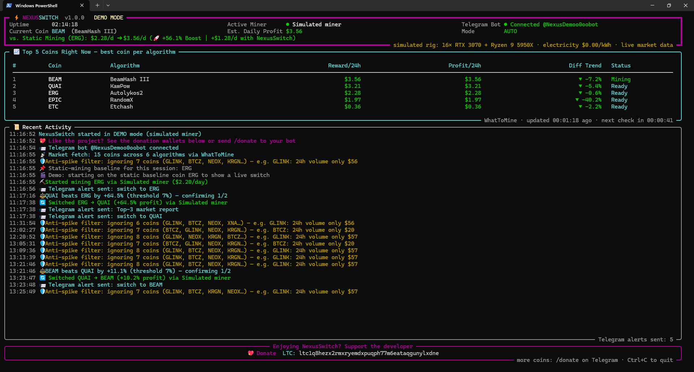
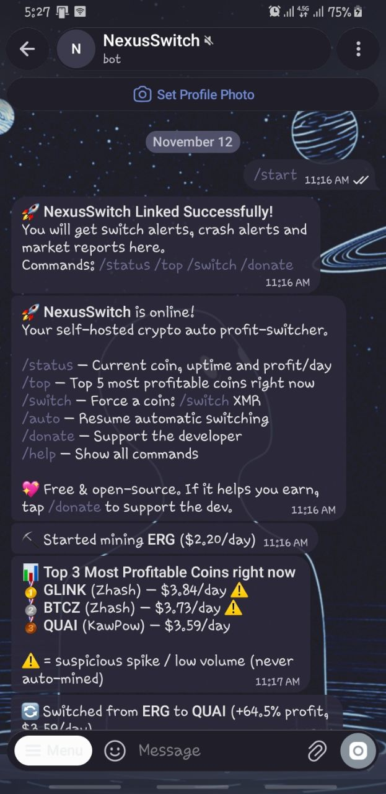
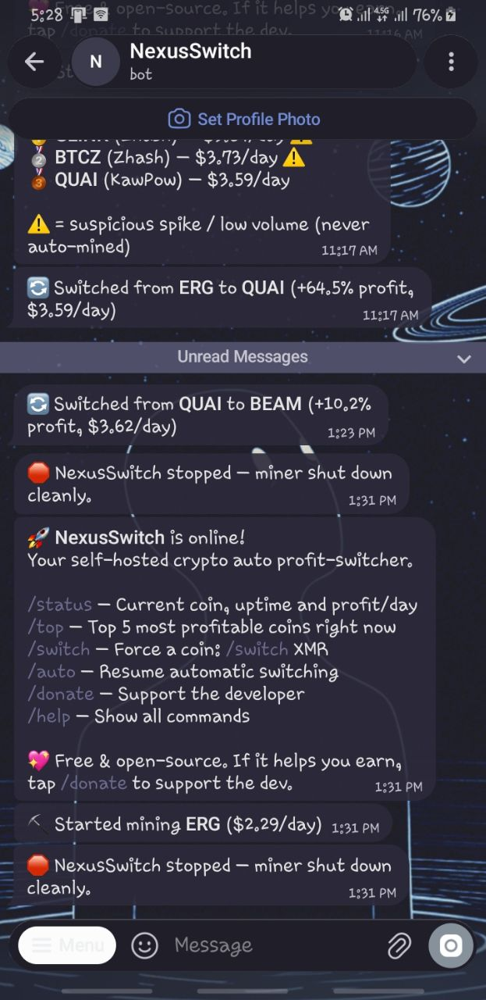

<div align="center">

# ⚡ NexusSwitch

### Open-Source Crypto Auto Profit-Switcher with a Self-Hosted Telegram Bot

**Always mine the most profitable coin. Get alerts on your phone. Pay nobody.**

[](https://www.python.org/)
[](LICENSE)
[](#-quick-start)
[](#-telegram-bot)
[](#-features)
[](#-contributing)

</div>

---

<a id="support--donate"></a>

## 💖 Support & Donate

NexusSwitch is **free, open-source and has no hidden fees**. If it makes you money, a tip keeps development going:

| Coin / Network | Address |
|---|---|
| **USDT (TRC20) / TRX** | `TAVHibFGZtAviidRntJ865WiTzZHPpyGcK` |
| **USDT (ERC20/BEP20) / ETH / BNB** | `0x2a41fff54CD971208CB2b22C283F88Bbdd80dC86` |
| **BTC** | `bc1qe7ru3cqa2me8yd3fxuyl5l84kuux5s70dj0jys` |
| **XMR** | `84v25MAGWRvQjDWSvc5juS8mWiTxDBN7Q8LXoKr2Mi36UcTTNKXnSNCVViJRtJ4Gwy4NmoELaekoEeftUsXDKvLFUN2XzuM` |
| **SOL** | `563hB2cnjKXM9YwtTSJBJAbYbA7dKjxqHjzGLtFLnWXP` |
| **LTC** | `ltc1q8hezx2rmxryemdxpuqph77m6eataqgunylxdne` |

<details>
<summary><b>More coins</b> — DOGE · BCH · ZEC · DCR · XNO · TON</summary>

| Coin / Network | Address |
|---|---|
| **DOGE** | `D8YFHRQwiWvJzJQAcgxBAYMWNWQb5PNFDB` |
| **BCH** | `bitcoincash:qpp3fdywurf0t6gf5cvegzl22jrurck0fyh82az9cg` |
| **ZEC (Unified)** | `u1w3ph6tg5j9fv3ps5gnpv8wurxaskls40ztg89pmhs6r85jdcxdayyenv7u2yshvjya6ek9722mtxmdaewwkjjfkdls4xj2c9hgcnjfxz` |
| **DCR** | `DsmnbZ38ZHhEmwnBcmnWyzqaoBrrvM57Lra` |
| **XNO (Nano)** | `nano_33pjgdrf1dbtzzcbpdnkcmzn3s46azof9eopsdpgh6c35wp7ckkshtahmbry` |
| **TON** | `UQAON17b-WB1PPQ9R_J16braRY_ZcskNYoc9YLbnbjqpdv6s` |

</details>

> Always double-check the network before sending. Inside the app, the same wallets are in the dashboard footer and the Telegram `/donate` command (tap to copy).

⭐ **Starring the repo is free and helps a lot.**

---

<div align="center">



<sub>Live dashboard in <code>--demo</code> mode: live market data, simulated 16× RTX 3070 + Ryzen 9 5950X rig, electricity $0.00/kWh.</sub>

</div>

## ✨ Features

- 🤖 **100% Free & Self-Hosted Telegram Bot** — your own bot, running on your own rig. No cloud, no subscription, no third party reading your stats. Only your linked chat can control it.
- 🛡 **Anti-Spike Smart Switching** — coins with near-zero volume or a sudden jump far above their 24h average are flagged `Spike?` and never auto-mined. A new coin must beat the current one by **>7% for 2 consecutive checks** before a switch (all configurable), so you don't lose shares to pool hopping.
- 💸 **Zero Server Costs** — only public market APIs. **No API keys required.**
- 🚀 **Boost vs. static mining** — the header and `/status` show what you would earn by sticking to one established coin versus what NexusSwitch is earning right now, e.g. `vs. Static Mining (ERG): $2.20/d ➔ $3.47/d (🚀 +57.7% Boost | +$1.27/d with NexusSwitch)`.
- 📈 **Real profit, not revenue** — estimated 24h USD for *your* hashrates, minus *your* electricity cost.
- 🖥 **Live terminal dashboard** — uptime, active miner, current coin, profit/day, Top 5 table, activity log.
- 🧹 **No zombie miners** — the whole miner process tree is terminated on every switch and on exit; miners orphaned by a crash or power cut are cleaned up on the next start.
- 🚑 **Crash recovery** — a dead miner is restarted automatically (and you get a Telegram alert). A coin that keeps crashing is benched for 30 minutes.
- 🧙 **2-minute setup wizard** — Telegram linking, hardware presets, wallets, pools and miner paths.
- ⛏ **Works with** XMRig, lolMiner, Rigel, SRBMiner-Multi and T-Rex.

**Algorithms:** RandomX · KawPow · Autolykos2 · Etchash · BeamHash III · Zhash · ZelHash (Equihash, AstroBWT and DynexSolve are tracked too, but need your own miner + `args`)

## 🚀 Quick Start

```bash
git clone https://github.com/MrM002/NexusSwitch.git
cd NexusSwitch
python -m venv .venv
.venv\Scripts\activate          # Linux/macOS: source .venv/bin/activate
pip install -r requirements.txt
```

**See it in 10 seconds** (live market data, simulated miner, no config needed):

```bash
python main.py --demo
```

**Real run** — the first launch starts the setup wizard:

```bash
python main.py
```

| Command | What it does |
|---|---|
| `python main.py` | Run (wizard on first launch) |
| `python main.py --demo` | Live dashboard with a simulated miner |
| `python main.py --setup` | Re-run the setup wizard |
| `python main.py --link-telegram` | Link / re-link the Telegram bot only |
| `python main.py --once` | Fetch the market once, print the dashboard, exit |
| `python test_core.py` | Offline self-test |

You need the miner programs themselves (download them from their official pages) — the wizard asks for the path to each `.exe`. Dropping them into a `miners/` folder next to NexusSwitch lets the wizard find them automatically.

### Single-file `.exe` (Windows)

```bat
build_exe.bat
```

produces `dist\NexusSwitch.exe` with PyInstaller. Put it in any folder and run it; `config.json` and `logs\` are created next to it.

## 🤖 Telegram Bot

<p align="center">
  
  
</p>

The wizard walks you through it:

1. Open **@BotFather** on Telegram
2. Send `/newbot`
3. Paste your **Bot Token** into the wizard
4. Send `/start` to your new bot — NexusSwitch captures your chat automatically and replies **"🚀 NexusSwitch Linked Successfully!"**

| Command | Result |
|---|---|
| `/status` | Current coin, uptime, profit/day |
| `/top` | Live Top 5 most profitable coins |
| `/switch XMR` | Force a coin remotely (auto-switching pauses for 60 min) |
| `/auto` | Resume automatic switching |
| `/donate` | Developer donation addresses (tap to copy) |

Automatic notifications:

- 🔄 `Switched from XMR to ZEPH (+14.2% profit)`
- 📊 Top 3 market report every 4 hours
- ⚠️ Miner crashed and was auto-restarted

The token lives only in your local `config.json`. It is never logged and never sent anywhere except `api.telegram.org`.

## ⚙️ Configuration

Everything is in `config.json` (created by the wizard — see [`config.example.json`](config.example.json)).

| Key | Default | Meaning |
|---|---|---|
| `switching.threshold_percent` | `7` | New coin must be this much more profitable |
| `switching.confirmations` | `2` | …for this many consecutive checks |
| `switching.check_interval_seconds` | `180` | Market polling interval |
| `switching.min_runtime_minutes` | `10` | Minimum time on a coin before switching again |
| `switching.min_volume_usd` | `10000` | Below this 24h volume a coin is flagged `Spike?` |
| `switching.spike_ratio` | `1.6` | Flag coins this far above their 24h average |
| `switching.mine_when_unprofitable` | `false` | Keep mining even when profit ≤ 0 |
| `electricity_cost_kwh` | `0` | USD per kWh, deducted from revenue |
| `hardware.hashrates` | — | Per algorithm, in **H/s** (Sol/s for Equihash family) |
| `hardware.power_watts` | — | Per algorithm, in watts |
| `donation_cycle` | `1%` | See below |

**Per-coin overrides.** Each coin can pin a miner and a custom argument template:

```json
"ZEC": {
  "wallet": "t1...", "pool": "zec.2miners.com:1010",
  "miner": "lolminer",
  "args": "--algo EQUI200_9 --pool {pool} --user {wallet}.{worker}"
}
```

Placeholders: `{pool}` `{host}` `{port}` `{url}` `{wallet}` `{worker}` `{algo}` (`{pool}` is `host:port`, `{url}` is `stratum+tcp://host:port`).

**TLS pools:** write the pool as `ssl://host:port` and NexusSwitch adds the right TLS option for the miner (`--tls`, `--tls on`, `--tls true` or a `stratum+ssl://` URL). Some ports only speak TLS — 2Miners Beam (`ssl://beam.2miners.com:5252`) is one.

**Built-in command lines** (flags checked against each miner's documentation):

| Miner | Algorithms | Command line |
|---|---|---|
| XMRig | RandomX (`rx/0`) | `-o {pool} -u {wallet} -p {worker} --rig-id {worker} -a rx/0 -k --no-color` |
| lolMiner | BeamHash III, Zhash, ZelHash, Etchash, Autolykos2 | `--algo BEAM-III --pool {pool} --user {wallet}.{worker}` (`EQUI144_5` adds `--pers`) |
| Rigel | KawPow, Autolykos2, Etchash | `-a kawpow -o {url} -u {wallet} -w {worker}` (+ `--coin rvn/quai/xna/erg`) |
| T-Rex | KawPow, Autolykos2, Etchash | `-a kawpow -o {url} -u {wallet} -p x -w {worker}` |
| SRBMiner-Multi | RandomX, KawPow, Autolykos2, Etchash | `--algorithm kawpow --pool {pool} --wallet {wallet}.{worker} --disable-cpu` |

Coins that share a family name on the market feed but use a different miner algorithm (EPIC, XDAG, ETI under RandomX) are never started with the default template — give them their own `miner` + `args`.

> Hashrate presets and default pools are starting points. Miner flags change between releases — check `logs/miner.log` if a coin does not start, and adjust `args` for your miner version.

### Market data

Minerstat's `/v2/coins` endpoint now requires an API key, so out of the box NexusSwitch uses the key-less **WhatToMine** public JSON plus **CoinGecko** (Coinbase fallback) for BTC/USD. If you have a free Minerstat key, put it in `data_source.minerstat_api_key` and it becomes the primary source with automatic fallback.

### How the boost is calculated

At the first market check NexusSwitch picks a **static baseline coin**: the most profitable established coin your rig can mine (XMR, ETC, RVN, ERG or ZEC), or the median eligible coin if you mine none of those. That coin stays the baseline for the whole session, like a miner who picks a coin and never switches. The boost is the current coin's estimated 24h profit against the baseline coin's, both from the same live data. `/status` also shows the gain accumulated over the session.

It is an estimate: it ignores the few seconds of downtime per switch, and when you are already on the baseline coin it honestly reads `on the best coin already`.

> `--demo` uses live market data with a simulated 16× RTX 3070 + Ryzen 9 5950X rig and **no electricity cost** (shown on the dashboard), starts on the baseline coin and then switches using the real threshold logic. Your numbers depend on your hardware, power price and the market.

## 💝 The donation cycle — fully transparent

- **Opt-in in the wizard**, default **1%** of mining time (≈6 minutes every 10 hours), hard-capped at 5%.
- Only happens while you are **already mining** a coin the developer publishes a mining wallet for — currently XMR, ETC, BTC, LTC, DOGE, BCH, DCR (see [`donations.py`](donations.py)). It never switches coins by itself; for any other coin it is simply skipped.
- Always announced in the activity log and shown as `DONATING` on the dashboard.
- Turn it off any time: `"donation_cycle": {"enabled": false}`.

There is no other fee, telemetry or network call. Read the code — it is about 2,300 lines of Python.

## 🗂 Project layout

| File | Role |
|---|---|
| `main.py` | Entry point, orchestration of all async tasks |
| `setup_wizard.py` | First-run wizard + Telegram linking |
| `profit_engine.py` | Market data, profit math, anti-spike filters, switch threshold |
| `miner_manager.py` | Miner command lines, process-tree control, crash detection |
| `telegram_bot.py` | Bot API long-polling, commands, notifications |
| `ui.py` | Rich dashboard |
| `config.py` / `donations.py` | Settings and developer wallets |

## 🤝 Contributing

Issues and PRs are welcome — new miners, coins, pools and hashrate presets especially. Run `python test_core.py` before opening a PR.

## ⚠️ Disclaimer

Profit figures are **estimates** from public data and can be wrong. Mining costs electricity and wears hardware. You are responsible for your wallets, pools, miner binaries and local laws. This software comes with no warranty (see [LICENSE](LICENSE)).

---

<div align="center">

## 💖 Support & Donate

If NexusSwitch earned you even one extra dollar, consider sending a little back:

</div>

| Coin / Network | Address |
|---|---|
| **USDT (TRC20) / TRX** | `TAVHibFGZtAviidRntJ865WiTzZHPpyGcK` |
| **USDT (ERC20/BEP20) / ETH / BNB** | `0x2a41fff54CD971208CB2b22C283F88Bbdd80dC86` |
| **BTC** | `bc1qe7ru3cqa2me8yd3fxuyl5l84kuux5s70dj0jys` |
| **XMR** | `84v25MAGWRvQjDWSvc5juS8mWiTxDBN7Q8LXoKr2Mi36UcTTNKXnSNCVViJRtJ4Gwy4NmoELaekoEeftUsXDKvLFUN2XzuM` |
| **SOL** | `563hB2cnjKXM9YwtTSJBJAbYbA7dKjxqHjzGLtFLnWXP` |
| **LTC** | `ltc1q8hezx2rmxryemdxpuqph77m6eataqgunylxdne` |
| **DOGE** | `D8YFHRQwiWvJzJQAcgxBAYMWNWQb5PNFDB` |
| **BCH** | `bitcoincash:qpp3fdywurf0t6gf5cvegzl22jrurck0fyh82az9cg` |
| **ZEC (Unified)** | `u1w3ph6tg5j9fv3ps5gnpv8wurxaskls40ztg89pmhs6r85jdcxdayyenv7u2yshvjya6ek9722mtxmdaewwkjjfkdls4xj2c9hgcnjfxz` |
| **DCR** | `DsmnbZ38ZHhEmwnBcmnWyzqaoBrrvM57Lra` |
| **XNO (Nano)** | `nano_33pjgdrf1dbtzzcbpdnkcmzn3s46azof9eopsdpgh6c35wp7ckkshtahmbry` |
| **TON** | `UQAON17b-WB1PPQ9R_J16braRY_ZcskNYoc9YLbnbjqpdv6s` |

<div align="center">

⭐ Star · 🍴 Fork · 📣 Share

Released under the [MIT License](LICENSE).

</div>
